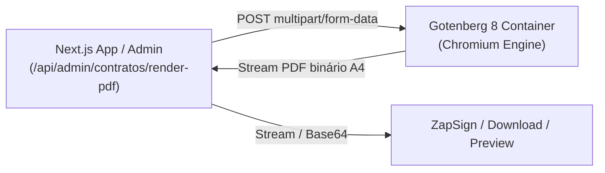

# Setup e Infraestrutura — Gotenberg PDF Engine (DuoLife Hub)

> **Status:** Configuração Oficial de Produção e Desenvolvimento  
> **Versão do Motor:** Gotenberg 8 (`gotenberg/gotenberg:8`)  
> **Objetivo:** Conversão de alta fidelidade de contratos HTML/Tailwind para PDF vetorial A4 de 300 DPI, com preservação de layouts timbrados, marcas d'água e âncoras da ZapSign.

---

## 1. Visão Geral da Arquitetura

O **Gotenberg** é um microserviço HTTP sem estado (*stateless*) construído sobre o Chromium que executa conversões de HTML para PDF com desempenho profissional.

### Por que o Gotenberg no DuoLife Hub?
1. **Desacoplamento e Imagem Docker Limpa:** Evita instalar o Chromium e pacotes C++ pesados na imagem Alpine do Next.js, mantendo o container da aplicação leve (~150MB) e rápido para iniciar.
2. **Fidelidade Visual Absoluta:** O Chromium interno do Gotenberg renderiza Tailwind CSS v4, Flexbox, Grid, Data URIs e fontes web com precisão milimétrica.
3. **Padrão de Mercado para Coolify:** Opera como container auxiliar na mesma rede Docker interna, comunicando-se via HTTP sem expor portas publicamente para a internet.



---

## 2. Configuração em Ambiente de Desenvolvimento Local

### 2.1 Comando Rápido via Docker CLI
Para iniciar o container localmente na porta `3001`:

```bash
docker run -d \
  --name duolife-local-gotenberg \
  -p 3001:3000 \
  --restart unless-stopped \
  gotenberg/gotenberg:8
```

### 2.2 Adicionando ao `docker-compose.yml`
No arquivo `docker-compose.yml` da raiz do projeto, adicione o serviço `gotenberg`:

```yaml
services:
  postgres:
    image: postgres:16-alpine
    container_name: duolife-local-postgres
    restart: always
    environment:
      POSTGRES_USER: duolife
      POSTGRES_PASSWORD: local_dev_password
      POSTGRES_DB: duolife_db
    ports:
      - "5433:5432"
    volumes:
      - duolife_pgdata:/var/lib/postgresql/data

  gotenberg:
    image: gotenberg/gotenberg:8
    container_name: duolife-local-gotenberg
    restart: unless-stopped
    ports:
      - "3001:3000"
    environment:
      - CHROMIUM_DISABLE_JAVASCRIPT=false
      - LOG_LEVEL=info

volumes:
  duolife_pgdata:
```

### 2.3 Variáveis de Ambiente Locais (`.env.local`)
Adicione no `.env.local`:

```env
# URL do motor Gotenberg local (porta mapeada no Docker)
GOTENBERG_URL=http://localhost:3001
```

*(Se a variável `GOTENBERG_URL` for omitida em desenvolvimento, o cliente `gotenberg-client.ts` assume automaticamente `http://localhost:3001` como fallback).*

---

## 3. Configuração de Produção no Coolify

No Coolify, o Gotenberg opera como um serviço Docker complementar dentro do mesmo Projeto e Ambiente da DuoLife Hub.

### Passo 1: Criar o Serviço Gotenberg no Coolify
1. Acesse o painel do **Coolify**.
2. Abra o Projeto **DuoLife Hub** e o ambiente de Produção.
3. Clique em **+ New Resource** -> **Docker Image**.
4. Configure os parâmetros do recurso:
   - **Name:** `duolife-gotenberg`
   - **Docker Image:** `gotenberg/gotenberg:8`
   - **Exposed Port(s):** Deixe vazio ou não exponha para a internet pública (comunicação 100% via rede interna Docker do Coolify).
   - **Port:** `3000` (porta interna do Gotenberg).
5. Em **Environment Variables** do Gotenberg (opcional para otimização):
   ```env
   CHROMIUM_DISABLE_JAVASCRIPT=false
   LOG_LEVEL=info
   ```
6. Clique em **Deploy**. O status deve mudar para `running:healthy`.

### Passo 2: Configurar a Variável de Ambiente no `duolife-hub`
1. No Coolify, abra o aplicativo principal **duolife-hub** (Next.js).
2. Vá na aba **Environment Variables**.
3. Adicione a variável:
   ```env
   GOTENBERG_URL=http://duolife-gotenberg:3000
   ```
   *(Ou use o FQDN interno fornecido pelo Coolify para o serviço `duolife-gotenberg`, por exemplo: `http://<service_uuid>:3000`).*
4. Marque como **Runtime-only** (ou Secret se preferir).
5. Reinicie/Redeploy a aplicação **duolife-hub**.

---

## 4. Parâmetros de Calibração A4 no Gotenberg

O cliente em `src/lib/gotenberg-client.ts` já envia por padrão a calibração milimétrica oficial para contratos A4:

| Parâmetro | Valor Padrão | Descrição |
| :--- | :--- | :--- |
| `paperWidth` | `8.27` | Largura da folha A4 em polegadas (210 mm) |
| `paperHeight` | `11.69` | Altura da folha A4 em polegadas (297 mm) |
| `marginTop` | `0` | Margem zero: controle milimétrico delegado ao CSS |
| `marginBottom` | `0` | Margem zero |
| `marginLeft` | `0` | Margem zero |
| `marginRight` | `0` | Margem zero |
| `printBackground` | `true` | Imprime fundos, marcas d'água e gradientes |
| `preferCssPageSize` | `true` | Respeita a diretiva `@page { size: A4; }` |
| `waitDelay` | `250ms` | Aguarda renderização de fontes e Tailwind CDN |
| `emulatedMediaType` | `print` | Aplica as regras `@media print` |

---

## 5. Endpoints e Rotas Disponíveis

### 5.1 Rota Administrativa de Renderização
- **URL:** `POST /api/admin/contratos/render-pdf`
- **Headers:**
  - `Content-Type: application/json`
  - `Accept: application/pdf` (ou `application/json` caso queira o Base64)
- **Exemplo de Payload:**
  ```json
  {
    "templateSlug": "rc_advogados_adesao",
    "dados": {
      "nome": "Dr. Carlos Eduardo Santos de Souza",
      "cpf": "123.456.789-00",
      "dataNascimento": "15/04/1985",
      "email": "carlos@exemplo.adv.br",
      "celular": "(11) 98765-4321",
      "enderecoCompleto": "Av. Paulista, 1000 - Cj 50 - Bela Vista - São Paulo/SP",
      "inicioProfissional": "10/02/2010",
      "oab": "SP 123.456",
      "importanciaSegurada": "R$ 100.000,00",
      "franquia": "Sem aplicação de franquia",
      "valorPremio": "R$ 790,00",
      "formaPagamento": "1x à vista no Boleto ou Cartão de Crédito"
    },
    "format": "pdf",
    "download": false
  }
  ```

### 5.2 Healthcheck do Motor
- **URL:** `GET /api/admin/contratos/render-pdf`
- **Retorno:**
  ```json
  {
    "status": "ok",
    "engine": "Gotenberg 8 (Chromium HTML-to-PDF)",
    "gotenbergUrl": "http://localhost:3001",
    "gotenbergAvailable": true,
    "help": "Serviço Gotenberg conectado e operacional."
  }
  ```

---

## 6. Validação e Scripts de Teste

Para validar a comunicação e a geração de contratos em PDF no disco:

```bash
# Executa o script de teste do Gotenberg
npx tsx scripts/test-gotenberg-pdf.ts
```

O PDF gerado será salvo em `scratch/contrato-teste.pdf` para conferência visual.
Caso o Gotenberg não esteja em execução, o script alertará detalhadamente com a instrução exata para iniciar o container Docker.
